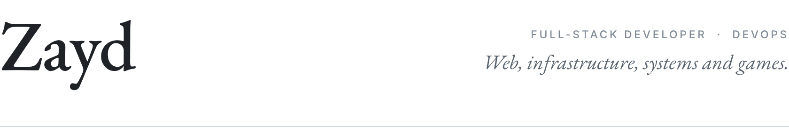
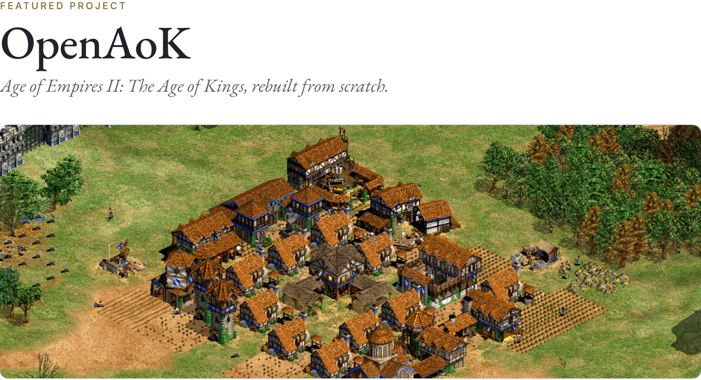
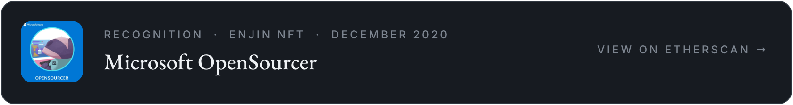

<picture><source media="(prefers-color-scheme: dark)" srcset="assets/header-dark.png"></picture>

<picture><source media="(prefers-color-scheme: dark)" srcset="assets/feature-dark.webp"></picture>

OpenAoK plays the 1999 game from your own copy of the CD, with the original rules, random maps, campaigns and computer players: one codebase for Windows, macOS, Linux, Android, iPhone and iPad, and the Nintendo Switch. 
[Repository](https://github.com/Zaydme/openaok) &nbsp;&middot;&nbsp; [Documentation](https://zaydme.github.io/openaok/) &nbsp;&middot;&nbsp; [Releases](https://github.com/Zaydme/openaok/releases)

 

<picture><source media="(prefers-color-scheme: dark)" srcset="assets/how-it-works-dark.png"></picture>

### Selected work

| Project | Work | Built with | Notes |
|:--|:--|:--|:--|
| [**OpenAoK**](https://github.com/Zaydme/openaok) | An engine for *Age of Empires II*, written from scratch, that plays the 1999 game from your own CD | C++20, SDL 2, EnTT | Six platforms |
| [**strapi-plugin-multi-select**](https://github.com/Zaydme/strapi-plugin-multi-select) | A multi-select custom field for the Strapi CMS | TypeScript, Strapi | 1.6M npm downloads |
| **Private platforms** | Head developer and system administrator for large production platforms: architecture, infrastructure, deployment and operations | Linux, Kubernetes, Docker Swarm, AWS, GCP, PostgreSQL, Proxmox, pgBackRest, Node.js, Go, Ruby on Rails, and more | Private |
| [**FightPandemics**](https://github.com/FightPandemics/FightPandemics) | A volunteer platform for local help during COVID-19. Built its real-time direct messaging over WebSockets, web notifications, organisation accounts and verified badges, and its moderation and BI dashboards | React, Fastify, Socket.IO, Redis, MongoDB | Senior full-stack developer, 2020 to 2021 |
| [**SVTrain**](https://github.com/com2u/SVTrain) | A tool for labelling images and training deep learning models on them. Built its file upload, workspace manager, colormaps, AI reports and statistics, and moved its image data to SQLite with caching for faster loading | Vue, Node.js, SQLite | Second-largest contributor, 2022 |
| [**polygon-faucet**](https://github.com/Zaydme/polygon-faucet) | A community faucet for Polygon's MATIC token, built and run | Next.js, Fastify, web3.js | 10,036 transactions sent |
| Others | Early experiments: simulations, a neural network that learns Flappy Bird, an unofficial Reddit client with Discord Rich Presence | p5.js, TensorFlow.js, Electron | 2019 |

 

